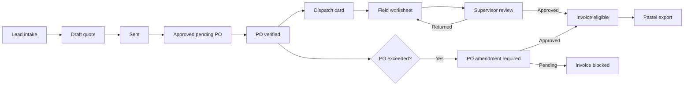
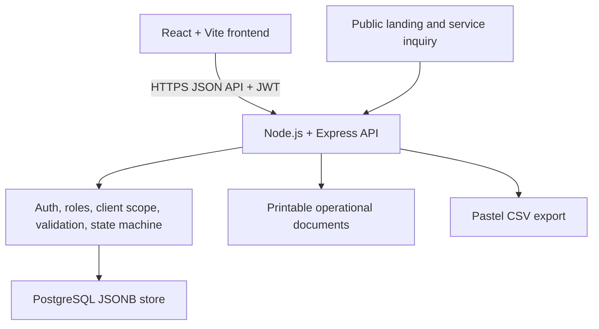

# Orac-IOS External Audit and Documentation Brief

## Purpose

Use this brief to audit, document, and improve Orac-IOS as an industrial
service management system for Orac Systems / Handon Enterprises. It is not a
generic marketing website and it must not be treated as one. Its business
purpose is to control traceable mining-service work from a lead through a
quote, client PO, field execution, approved evidence of work, invoice, and
accounting export.

This document is an evidence-based handover. Claims marked `VERIFIED` were
observed in source, an automated test, or a live non-sensitive health check.
Claims marked `REQUIRES AUDIT` must be inspected before being documented as
complete.

## Table of Contents

1. [System Mission](#system-mission)
2. [Current Deployment and Evidence](#current-deployment-and-evidence)
3. [Non-Negotiable Controls](#non-negotiable-controls)
4. [Business Vocabulary](#business-vocabulary)
5. [Roles and Responsibilities](#roles-and-responsibilities)
6. [Workflow Model](#workflow-model)
7. [Current Demonstration Data](#current-demonstration-data)
8. [Architecture](#architecture)
9. [UI and Product Requirements](#ui-and-product-requirements)
10. [Security and Data Protection](#security-and-data-protection)
11. [Known Gaps and Audit Priorities](#known-gaps-and-audit-priorities)
12. [Required Documentation Deliverables](#required-documentation-deliverables)
13. [Rules for Any Implementation Work](#rules-for-any-implementation-work)
14. [Acceptance Evidence](#acceptance-evidence)

## System Mission

Orac-IOS supports heavy industrial field service, particularly mining
maintenance and wear-protection work. It must make the commercial and
operational chain visible and auditable:

`Lead -> Quote -> Client approval -> PO verification -> Dispatch -> Worksheet and timesheet -> Invoice -> Pastel export`

The differentiating control is that a client PO reference and verified value
must exist before normal invoicing, and a PO amendment must block invoicing
when approved work exceeds the PO value. The system must also make every
record traceable to the client, mine site, plant, plant section, and equipment
tag where applicable.

## Current Deployment and Evidence

| Area | Location | Status |
| --- | --- | --- |
| Frontend source | `brianlupao123/Orac-IOS-Industrial-Service-Management` | React/Vite static frontend on Render. |
| Backend source | `brianlupao123/orac-portal-api` | Node.js/Express API on Render. |
| Database | Neon PostgreSQL JSONB store | Live pilot database. |
| API health | `GET /healthz` | VERIFIED: HTTP 200 returned `success`, `status`, and `store_driver: postgres`. |
| Backend tests | `npm test` | VERIFIED: 34 passing tests before data application. |
| Frontend build | `npm run build` | VERIFIED before current deployed UI changes. |
| SPA direct routes | Render rewrite | VERIFIED: public, login, password recovery, reset, and access-request routes returned HTTP 200 after rewrite configuration. |
| Curated demonstration data | Neon pilot store | VERIFIED: applied on 2026-09-12 after creating backup id `1`. |

Do not copy, print, commit, or request credentials, passwords, hashes,
connection strings, JWT secrets, reset tokens, personal data, or raw database
contents in audit reports.

## Non-Negotiable Controls

1. Backend code is the source of truth for authorization, client scoping,
   workflow transitions, and invoice eligibility.
2. Workflow transition sequence must remain:
   `Draft -> Sent -> Approved_Pending_PO -> PO_Verified -> Invoiced`.
3. A PO reference must be mandatory before PO verification or invoicing.
4. An invoice must be blocked when a PO requires an amendment.
5. An invoice must be blocked until required field work has received
   supervisor approval.
6. A Client Viewer can access only records belonging to its own client.
7. Client invoice access is allowed only after server-side client scoping. This
   was corrected in backend commit `a43c8d2` with an automated isolation test.
8. Stock may not become negative without an explicit authorized override.
   Only Admin and Operations are currently allowed to override negative stock.
9. Do not add a fake AI assistant, browser-shipped credentials, or a hidden
   authentication bypass.
10. The database must be backed up before any demo reset, import, migration,
    or destructive repair.

## Business Vocabulary

| Term | Meaning | Relationship |
| --- | --- | --- |
| Lead | A public inquiry or possible service opportunity. | May become a client and quote. |
| Quote / Quotation | A priced commercial proposal for defined work. | Linked to client and, where known, equipment. |
| Purchase Order (PO) | Client commercial authorization with reference and value. | Required to verify commercial authority. |
| Dispatch Card / Job Card | The planned field assignment created for approved work. | Linked to quote, PO, asset, and assigned technician. |
| Field Worksheet | A dated on-site record of work performed, outcomes, and supervisor review. | Evidence of execution; not a billing record by itself. |
| Timesheet | A record of labour hours and rate. | Supports labour costing and PO variance calculations. |
| Material Usage | Stock or material consumed by a dispatch. | Supports cost and PO variance calculations. |
| PO Amendment | Formal client authorization to increase or change PO value. | Required when logged work exceeds PO value. |
| Invoice | Financial claim generated only after controls pass. | Linked to dispatch, PO, and approved work evidence. |
| Pastel Export | Accounting bridge/export for invoice data. | Must contain only invoice-eligible records. |

The documentation must explicitly distinguish a worksheet from a timesheet:
worksheets demonstrate what was done on site; timesheets capture labour hours
and costs. A dispatch card is the assignment, not proof of completion.

## Roles and Responsibilities

| Role | Primary responsibility | Expected capabilities |
| --- | --- | --- |
| Admin | System governance and master administration. | Users, roles, company profile, clients, assets, catalog, inventory, workflow oversight. |
| Management | Commercial and operational oversight. | Client and asset administration, reports, inventory visibility, approvals defined by backend policy. |
| Sales | Lead conversion and quotation control. | Lead intake, client selection, quote creation and sending; no invoicing. |
| Finance | PO and invoicing control. | PO verification, amendment decision support, invoicing, Pastel export, financial reports. |
| Operations | Field delivery coordination. | Dispatch planning, asset linkage, inventory operations, worksheet oversight. |
| Supervisor | Quality and work-evidence review. | Dispatch oversight, worksheet review, approve or return worksheets. |
| Technician | On-site execution. | Assigned work visibility, create/update/submit worksheets and time evidence. |
| Client Viewer | Client self-service. | View only own quotes and invoices; submit own PO reference where permitted. |

The external reviewer must map every visible page action to a backend
permission and test that unavailable actions are not merely hidden but denied
by the API.

## Workflow Model

## Current Demonstration Data

The live pilot database now has controlled fictional demonstration records,
not client production data. It includes:

- three industrial clients and four mine sites;
- mine site -> plant -> plant section -> equipment-tag hierarchy;
- six quotes representing the valid commercial pipeline states;
- verified POs, one amendment-required PO, active and completed dispatches;
- draft, submitted, returned, and supervisor-approved worksheets;
- linked timesheets, material usage, stock, suppliers, one invoice, an access
  request, notification, and lead;
- preserved user records and a Client Viewer linked to the Zimplats demo
  client.

The seed utility is `scripts/seed-curated-demo.js`. It is dry-run by default,
requires explicit confirmation to apply, and creates a database snapshot. The
corresponding restore utility is `scripts/restore-demo-backup.js`. The current
backup reference is `1`; do not restore it without owner approval.

## Architecture

Current frontend and backend are separate deployment repositories. This is
acceptable for the pilot, but a monorepo migration must not begin until a
file-by-file reconciliation proves the two deployment sources and canonical
working source are aligned.

## UI and Product Requirements

The product has two experiences which must remain separate:

1. **Public service entry:** concise industrial positioning, services,
   industries, contact/lead form, and portal sign-in. It must direct users to
   operational action; it must not imitate a generic brochure site.
2. **Authenticated operations portal:** dense, calm, role-specific work
   surfaces for repeated business tasks.

UI requirements:

- Use Orac brand colors: primary blue `#6EC1E4`, slate `#54595F`, white
  `#FFFFFF`, with an 8px spacing rhythm.
- Use readable desktop and tablet typography; do not use tiny text as a
  substitute for information design.
- Show a visible sign-out action in addition to the profile dropdown.
- Keep the login route functional without the unnecessary dark promotional
  split panel. This is implemented in frontend commit `86e9ceb` and requires
  Render deployment confirmation.
- Every empty state must explain the missing operational record and show an
  allowed next action where the role can create one.
- Avoid dashboards that show a Technician or Client Viewer organisation-wide
  financial/client KPIs. The current screenshots show this problem and it is
  a required correction.
- Client Portal must not render a permission error for an intended feature.
  It should show scoped invoices or a professional empty state.
- The UI must expose actual CRUD workflows only where a role is authorized;
  controls need labels, confirmation, validation feedback, cancel paths, and
  server-refresh after mutation.

## Security and Data Protection

| Control | Required standard |
| --- | --- |
| Authentication | Password hash verification and signed JWTs; never expose secrets in frontend or documentation. |
| Authorization | Enforced in API controllers/middleware, not only through navigation visibility. |
| Client isolation | Filter owned records server-side for Client Viewer users. |
| Financial integrity | PO reference, PO verified state, amendment block, approved worksheet block. |
| Input validation | Validate all mutations at API boundary. |
| Auditability | Write an audit event for material state changes and approvals. |
| Demo separation | Clearly label pilot data; do not mix demo records with real client data. |
| Backup and recovery | Backup before reset/import; document restore test and retention policy. |
| Production configuration | Secrets only in environment variables; production must require PostgreSQL. |

Known configuration follow-up: the PostgreSQL connection issued an SSL mode
compatibility warning during the demo seed. Review the Neon connection string
and use the provider-recommended explicit SSL mode before production launch.
Do not paste the connection string into a ticket or report.

## Known Gaps and Audit Priorities

| Priority | Item | Required outcome |
| --- | --- | --- |
| P0 | Role-scoped dashboards | Technician, Supervisor, and Client Viewer must see only their own relevant KPIs and records. Audit generic collection endpoints for data overexposure. |
| P0 | Deployment verification | Confirm Render has deployed frontend `86e9ceb` and backend `4548578`; capture build logs and role-based browser UAT. |
| P1 | CRUD completion | Audit create/read/update/archive paths for clients, assets, catalog, suppliers, stock, quotes, dispatches, worksheets, and users. Do not claim CRUD merely because a list page exists. |
| P1 | Worksheet/timesheet UX | Make the difference explicit in labels, forms, review rules, and reports. |
| P1 | Client Portal | Confirm scoped quote, PO submission, and invoice rendering against live demonstration data. |
| P1 | AI assistant | No real deployed AI assistant exists. Define a bounded use case, approved provider, privacy rules, audit trail, and cost controls before implementation. Do not ship a mock as a production feature. |
| P2 | Documentation | Produce the deliverables below only from source and live evidence. |
| P2 | Architecture consolidation | Build a reconciliation inventory before any monorepo move. |

## Required Documentation Deliverables

Create these Markdown documents with clickable tables of contents, stable
headings, diagrams, tables, version/date/owner, and an evidence section. Do
not include secrets or personal data.

1. **System Overview and Pitch**: problem, users, value, workflow, screenshots
   from the live demo, architecture, business benefits, limits, and next steps.
2. **Software Architecture Document**: context, deployment topology, frontend,
   backend, API boundary, database storage, integrations, environments,
   observability, backup, and migration plan.
3. **Functional Requirements Specification**: each module, role, CRUD action,
   state guard, error state, and acceptance criteria.
4. **Non-Functional Requirements**: availability, security, performance,
   accessibility, audit retention, data integrity, maintainability, backups,
   recovery, and compliance assumptions.
5. **Role and Permissions Matrix**: visible screens, allowed actions, denied
   actions, API enforcement, and test cases per role.
6. **Workflow and Data Dictionary**: definitions, state transitions, required
   fields, entity relationships, and example record flows.
7. **User Manuals**: separate task-oriented manuals for Admin, Sales,
   Operations, Technician, Supervisor, Finance, Management, and Client Viewer.
8. **Deployment and Operations Runbook**: Render, Neon, environment variables
   by name only, release checklist, rollback, backup/restore, health checks,
   incidents, and credential rotation.
9. **Test and UAT Plan**: role-by-role cases, expected API/UI behavior, sample
   non-sensitive test evidence, defects, and sign-off table.
10. **UX Wireframes and Screen Inventory**: public landing, login, dashboard by
    role, quote, PO, dispatch, worksheet, timesheet, inventory, reports,
    client portal, and administration. Use diagrams or wireframes that reflect
    actual screens, not imagined features.

## Rules for Any Implementation Work

1. Scan actual current source before proposing an edit. Treat historic reports
   as leads, not truth.
2. Do not overwrite another branch, deployment clone, or generated worktree.
3. Make one bounded change per commit with tests and a rollback path.
4. Do not change workflow, PO, invoice, worksheet approval, or client-scope
   logic without targeted regression tests.
5. Do not run `seed-realistic.js` or `load-massive-seed.js`; they overwrite the
   store and are not approved for the pilot.
6. Do not expose or regenerate credentials in UI, source, scripts, reports,
   commits, chat, or screenshots.
7. Do not add artificial metrics, fake AI, or UI placeholders labelled as
   working enterprise capabilities.

## Acceptance Evidence

For any claimed capability, attach one or more of:

- source file and line reference;
- passing automated test name;
- redacted HTTP status and response shape;
- build output;
- browser UAT screenshot with no personal data or credentials;
- deployment commit hash and Render log;
- database backup/restore test result.

Never mark a feature complete based solely on a mockup, a navigation link, or
an AI-generated summary.
