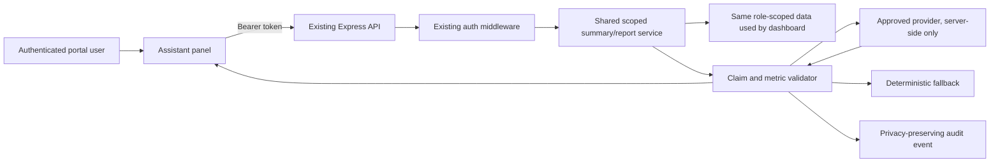

# Orac-IOS Governed AI Assistant Plan

**Status:** design only. No provider connection, model call, UI component, route, or credential is implemented by this document.  
**Purpose:** add a role-aware analytics narrator that explains already-authorized dashboard data without becoming a decision-maker, a raw database query tool, or an alternate authorization path.

## Table of Contents

1. [Recon Findings](#recon-findings)
2. [Product Boundary](#product-boundary)
3. [Approved Architecture Direction](#approved-architecture-direction)
4. [Grounding and RBAC Controls](#grounding-and-rbac-controls)
5. [Role Rollout](#role-rollout)
6. [API and Data Contract](#api-and-data-contract)
7. [Audit, Privacy, and Cost Controls](#audit-privacy-and-cost-controls)
8. [Implementation Gates](#implementation-gates)

## Recon Findings

### Repository Structure

| Area | Current location | Evidence |
| --- | --- | --- |
| Backend entry point | `server.js` | Express server, health endpoint, persistence middleware, and API router. |
| Backend routes | `src/router.js` | Public routes precede `authMiddleware`; protected routes begin after it. |
| Backend controllers | `src/controllers/` | Auth, core, quote, dispatch, inventory, reports, documents, notifications, access requests, and administration controllers. |
| State machine | `src/stateMachine.js` | Quote lifecycle, dispatch creation, invoice eligibility, and invoice creation. |
| Authentication | `src/middleware/auth.js` | JWT verification plus current-account revalidation. |
| Frontend application | `frontend deploy source/src/App.jsx` | React routes and role-gated page mounting. |
| Frontend dashboards | `frontend deploy source/src/pages/DashboardPage.jsx` | Loads `/summary`, permitted generic collections, and role-specific cards. |
| Frontend reports | `frontend deploy source/src/pages/ReportsPage.jsx` | Requests existing guarded report endpoints. |
| Database | Neon PostgreSQL JSONB pilot store | `src/pool.js` and `src/postgresStore.js`. |

### AiAssistant Status

`AiAssistant.jsx` is absent from the current deployed frontend source. A repository search found no assistant component, import, route, or backend AI endpoint. The prior decision to avoid a fake assistant was therefore correctly preserved.

### Field Dispatch: Resolved Fact

`Field_Dispatch` is both a valid quote state and the transition that creates a linked dispatch record.

- `src/stateMachine.js:3-9` allows `Approved_Pending_PO -> Field_Dispatch`, `PO_Verified -> Field_Dispatch`, and `Field_Dispatch -> Invoiced`.
- `src/stateMachine.js:52-62` requires dispatch permission and either a PO or an explicit urgent pre-PO authorization.
- `src/stateMachine.js:83-117` creates a pending urgent PO when necessary, then creates the `dispatch_cards` record with the quote and PO linkage.
- An urgent path requires `started_before_po: true` and a non-empty `urgent_reason`; invoice eligibility remains guarded later.

### PO Underrun: Resolved Fact

PO underrun is allowed by the current source.

- `src/store.js:242-261` calculates `logged_value` and sets `requires_amendment` only when `logged_value > po_amount`.
- `src/stateMachine.js:64-77` blocks invoicing only when the PO is unverified, worksheet evidence is absent, or `requires_amendment` is true.
- `src/stateMachine.js:122-141` calculates invoice total from recorded labour and materials, falling back to quote total when no recorded cost exists.

Therefore a genuine under-PO recorded total does not require an amendment and can invoice. This remains SOURCE + AUTOMATED VERIFIED, not yet live-UAT verified.

### Dashboard Scope: Current Status

- Backend summary scoping: `src/controllers/coreController.js:107-132` removes client, quote, invoice, and PO values for Technician/Supervisor and scopes operational records.
- Backend collection scoping: `src/controllers/coreController.js:81-104` scopes Technician assigned work and Supervisor review work.
- Automated coverage: `tests/dashboardScope.test.js` is part of the current **56 passing** backend tests.
- Frontend behavior: `frontend deploy source/src/pages/DashboardPage.jsx:28-57` avoids loading generic quotes for field roles; `:276-305` hides organisation KPI cards for `FIELD_DASHBOARD_ROLES`.

The code is SOURCE + AUTOMATED VERIFIED. Render deployment and browser observation remain LIVE-UNVERIFIED.

## Product Boundary

The assistant may:

- explain counts, exceptions, queues, and variance already returned to the authenticated role;
- translate verified current metrics into concise operational language;
- direct users to the existing dashboard page or workflow action;
- accept a user flag when an answer is misleading or wrong.

The assistant may not:

- create, edit, approve, dispatch, invoice, void, export, or otherwise mutate business data;
- query a raw database, call unscoped generic collections, or bypass existing permission checks;
- invent figures, give legal/accounting approval, or override workflow controls;
- receive secrets, connection strings, passwords, tokens, or browser-side provider credentials.

## Approved Architecture Direction

Use the existing Node.js/Express backend. Do not create a microservice.

The implementation must first extract the summary-building logic currently used by `getSummary` into a reusable internal service. Both `GET /summary` and any AI route must call that same service with the authenticated actor. The AI route must not loop back through HTTP, and it must not implement its own role logic.

## Grounding and RBAC Controls

1. **Existing RBAC first.** `authMiddleware` establishes the current user. Existing permission and scope services remain the only authority.
2. **Same data service.** The assistant receives only the metric payload returned by the shared dashboard summary/report service for that actor.
3. **Structured output.** The model must return JSON containing only approved claims, metric keys, and values. Example: `{ "claims": [{ "metric": "blocked_amendments", "value": 2, "sentence": "Two POs need amendment review." }] }`.
4. **Server validation.** Each returned metric/value pair must exactly match the source payload. Unknown keys, mismatched numbers, unsupported statuses, or malformed JSON invalidate the response.
5. **Deterministic fallback.** On provider failure, timeout, malformed output, or failed grounding, return a short template generated directly from the verified metric payload. Never return an unverified model answer.
6. **No free-form data retrieval.** Initial chat intents are limited to: `dashboard_briefing`, `attention_items`, `metric_explanation`, and `workflow_guidance`. Free-form questions may be accepted only when they are mapped to one of those intents without adding data access.

## Role Rollout

| Phase | Roles | Scope | Gate |
| --- | --- | --- | --- |
| 0 | None | Design, provider review, test fixtures, deterministic templates | No provider calls. |
| 1 | Operations, Finance | Summary and permitted report explanations | Live deployment and role UAT completed. |
| 2 | Admin, Management, Sales, Client Viewer | Only existing scoped summaries and report capabilities | Phase 1 grounding, privacy, cost, and feedback controls pass. |
| 3 | Supervisor, Technician | Assigned/review-scoped operational briefings only | Render and browser UAT prove dashboard and collection scoping for both roles. |

Technician and Supervisor are intentionally gated last. They must never receive assistant output until their scoped live behavior has been confirmed.

## API and Data Contract

Proposed protected backend endpoints:

| Route | Purpose | Input | Output |
| --- | --- | --- | --- |
| `POST /api/ai/briefing` | Deterministic or grounded dashboard narrative | Optional approved intent | Narrative, metric citations, fallback indicator, request id. |
| `POST /api/ai/chat` | Intent-constrained question about current permitted dashboard data | Question and approved intent | Grounded response or deterministic fallback. |
| `GET /api/ai/health` | Internal provider/configuration readiness only | None | Provider readiness and no secret/config values. |
| `POST /api/ai/feedback` | Flag a questionable answer | Request id, category, optional comment | Acknowledgement and audit event. |

Routes stay inside `src/router.js` after `authMiddleware`. Their controller derives user identity from `req.user`; it must ignore any role, client, user id, record id, or scope supplied by the browser.

## Audit, Privacy, and Cost Controls

Every request needs an audit event containing request id, user id, role, approved intent, source metric names, timestamp, response mode (grounded model or deterministic fallback), model identifier, token counts, latency, and feedback status.

Raw prompts and raw answers can contain accidental personal or commercial data. Therefore the default audit event stores a redacted prompt summary and response claim identifiers, not unrestricted raw text. This is a safer interpretation of traceability and prevents the audit log becoming a second uncontrolled data store.

Required controls before provider activation:

- provider API key held only in backend deployment secrets;
- maximum input/output token limits per request;
- daily and monthly budget thresholds with server-side refusal after limit;
- rate limit per user and per organization;
- timeout, retry cap, and circuit breaker;
- visible response label: `Verified dashboard summary` or `Template fallback`;
- visible “Flag this answer” action with no workflow side effects;
- retention period and authorised access policy for AI audit events.

## Implementation Gates

Implementation may begin only when all of the following are recorded:

1. Render has deployed a backend revision containing `7a50b95` and frontend `e91187d` or later.
2. Operations and Finance live UAT confirms their current dashboards and reports work as intended.
3. Provider, data-processing terms, cost owner, monthly budget, retention period, and support owner are approved.
4. A test suite proves role scope parity between `GET /summary` and AI metric retrieval for all eight roles.
5. A test suite proves grounding rejection and deterministic fallback for altered numbers, unsupported claims, provider timeout, and malformed model output.
6. Security review confirms provider calls leave only from the backend and no assistant route mutates business data.

After the gates, implementation order is: shared summary service -> deterministic briefing -> audit/feedback/cost controls -> provider adapter -> grounded UI panel -> Operations/Finance pilot -> broader role rollout.
