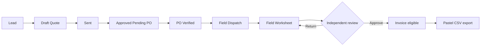
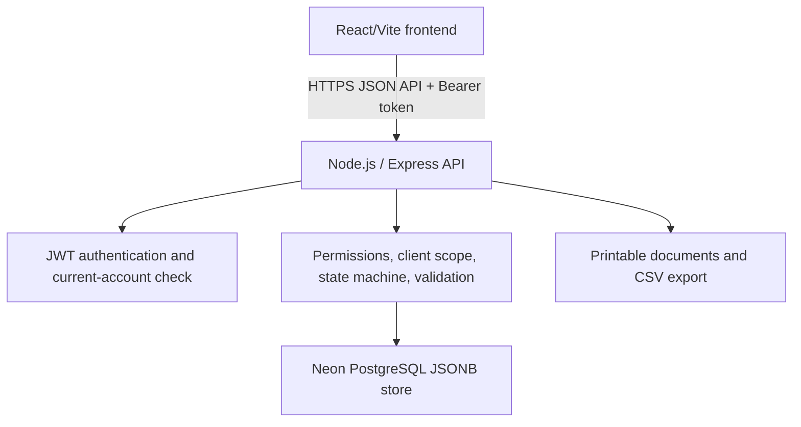

# Orac-IOS System Handover

**Audience:** Orac Systems / Handon Enterprises leadership, operational users, support staff, and future developers.  
**System name:** **ORAC-IOS: Orac Industrial Operations System.**
**System purpose:** controlled, traceable industrial field-service work from lead through quotation, client authorization, field execution, invoice, and accounting export.  
**Evidence rule:** source-backed behavior and automated tests are not called live-verified until observed on the deployed system.

## Table of Contents

1. [System Status](#system-status)
2. [Business Problem and Outcome](#business-problem-and-outcome)
3. [Roles and Operating Model](#roles-and-operating-model)
4. [Business Workflow](#business-workflow)
5. [Glossary and Data Model](#glossary-and-data-model)
6. [Architecture and Deployment](#architecture-and-deployment)
7. [Security and Financial Controls](#security-and-financial-controls)
8. [User Task Guide](#user-task-guide)
9. [Operations Runbook](#operations-runbook)
10. [Acceptance, Risks, and Next Steps](#acceptance-risks-and-next-steps)

## System Status

**Current update (2026-10-21):** A read-only Dispatch Job Card and an
Invoice Readiness evidence view are now implemented locally across the
designated backend and internal D: frontend. The Job Card is field-safe and
role-scoped. Invoice Readiness is limited to Admin, Management and Finance and
shows the actual server gate result, evidence totals, PO consumption and an
explicit blocker reason. It does not create, amend or issue an invoice. V5
calculations remain unavailable rather than estimated, and the existing
`V5_AMENDMENT_COVERAGE_NOT_IMPLEMENTED` fail-closed boundary is unchanged.
The current backend suite passed **1,123/1,123**; the current frontend suite
passed **472/472** and its production build completed after the PO and Quote
evidence-card additions and separately gated Quote, PO, Dispatch, Timesheet and Service Request analysis
surfaces. The controls remain hidden unless both the local frontend gate and
`ORAC_RECORD_TRAIL_V1` are deliberately enabled; neither has been enabled.
These are local,
fictional-data automated checks. Role-scoped browser screenshots, real database
concurrency testing, deployment and release approval remain outstanding.

**Latest scoped update (2026-10-22):** The owner confirmed that additional work or materials may be evidenced first and that a PO amendment is approved during monthly reconciliation. The backend requires an evidenced overrun and an amended amount that covers it before an independent Admin or Finance approver can clear the legacy invoice block. Dispatch still requires the initial verified PO; this is not a pre-PO or unrestricted pricing path. The first-release USD V5 policy is implemented locally: revisions retain cent snapshots, reject tax calculation, and are commercially accepted only through verified-PO authority. The separate V5 writer is implemented but remains dark behind both V5 flags. It produces immutable draft, invoice, line, source-consumption, event, idempotency and number-ledger records; it rechecks current evidence and authority at issue time, requires a different Finance/Admin issuer, and refuses cross-lineage, over-ceiling, duplicate-coverage and legacy-invoice cases. Its independent preview stays read-only and still retains `V5_AMENDMENT_COVERAGE_NOT_IMPLEMENTED`. On 2026-10-22, four guarded concurrency and rollback cases passed on an isolated local PostgreSQL 16.15 database with two independent server instances. No V5 flag has been enabled. Fictional role UAT, reviewed checkout capture, hosted-environment verification and written release approval remain required. This is not tax, FX, credit-note, accounting integration, portal UI delivery, deployment or live-data validation.

**Current update (2026-10-19):** The Supplier record-analysis slice is now implemented locally under the existing `ORAC_RECORD_TRAIL_V1` gate and tested as part of `npm.cmd run maintain` (**1,065/1,065 passed**). It is limited to Admin, Management and Operations, and summarizes source-linked stock/receipts and existing ledger reconciliation without exposing contact data or raw document references. This is still backend-only; the flag remains off, with no deployment, live-data check or frontend integration. This dated update supersedes earlier test counts and feature lists in this handover.

The associated API contract is `ORAC_AI_RECORD_ANALYSIS_API.md`; the consolidated Chat 1-7 progress register at the workspace root has also been updated. This is typed record lookup, not unrestricted conversational analysis of every system action.

**Current source baseline (2026-10-19):** The authoritative backend working tree is `two-concept-packet-backend-20261005-235259`, branch `codex/fix-fictional-pilot-json-store`, HEAD `490822b9a4b1c37751b10ddcf85feacf8e713e29`. It is intentionally dirty and has not been committed, deployed, or declared production-ready. The internal D: frontend is a separate dirty checkout; its recent test/build results are recorded in the workspace reconciliation, not independently re-run here. The public website is a separate application. The historical deployment and commit notes below must not be taken as proof of the current live revision. The latest Windows `npm.cmd run maintain` passed **1,073/1,073**, including standalone Field Worksheet analysis. The feature remains a typed, deterministic API capability, not frontend-integrated or general conversational all-record analysis. `ORAC_RECORD_TRAIL_V1` remains off; no deployment or flag activation followed.

| Area | Current status | Evidence |
| --- | --- | --- |
| Internal backend source | LOCAL DIRTY WORKTREE; NOT RELEASED | HEAD and working-tree status above. Preserve all existing changes. No deployment or live-data verification was performed for this handover update. |
| Public lead retry safety (`Idempotency-Key`) | LOCAL SOURCE + AUTOMATED TESTS; NOT RELEASED | The integrated-path checkpoint is recorded in `PUBLIC_LEAD_IDEMPOTENCY.md`; included in the latest full backend maintenance gate, **1,073/1,073 passed (2026-10-19)**. Public-website joint acceptance, live PostgreSQL, browser CORS and release approval remain outstanding. |
| PO/dispatch authorization and reconciliation amendments | LOCAL SOURCE + REAL-ROUTER HTTP AND UNIT TESTS | The disposable HTTP test confirms pending/urgent attempts refuse without a dispatch, Sales verification is attributed, Technician is denied, and Operations dispatches only after PO verification. Amendment approval requires recorded overrun evidence, independent Admin/Finance approval, and an amount covering the evidence; invoice readiness remains blocked until then. Deployed policy and live role UAT are not verified. |
| Lead-notification destination | LOCAL SOURCE + FOCUSED AND FULL AUTOMATED TESTS | Admin and Sales alerts open the existing D: `/quotations` lead list without claiming an exact lead deep link. Management is not sent to that mutation-capable route; its safe dashboard fallback remains until a read-only destination or recipient-policy change is approved. Browser click-through is not verified. |
| Legacy invoice gate | LOCAL SOURCE + FOCUSED AUTOMATED TESTS | Invoice amount is checked against remaining verified PO value; malformed numeric evidence and invalid claimed Timesheet links are blocked. This does not establish rate authority or prove that the computed amount matches the accepted commercial price. |
| V5 invoice calculation and writer | LOCAL TWO-FLAG WRITER IMPLEMENTED; NOT RELEASED | The V5 preview remains read-only and retains its amendment-coverage blocker. The separate writer has immutable draft/issue records, exact evidence consumption, two-person issuance, amendment lineage and ceiling controls, and role-scoped reads. Four guarded concurrency/rollback cases passed on isolated local PostgreSQL 16.15 on 2026-10-22. It remains disabled pending fictional role UAT, reviewed checkout evidence, hosted-environment verification and explicit release approval. See `V5_INVOICE_PREVIEW_CONTRACT.md`, `CONTROLLED_COMMERCIAL_PRICING_PROPOSAL.md` and `V5_INVOICE_WRITER_RELEASE_GATES.md`. |
| ORAC AI | PROVIDERLESS, DETERMINISTIC, ROLE-SCOPED GUIDE/BRIEFING; TYPED ANALYSIS FOR QUOTE, DISPATCH, FIELD WORKSHEET/TIMESHEET, LIMITED INVOICE, PURCHASE ORDER, SUPPLIER, MAINTENANCE SCHEDULE, EQUIPMENT TAG, MATERIAL USAGE, CATALOG ITEM, STOCK ITEM, MONTHLY WORKSHEET REGISTER AND SERVICE REQUEST | Standalone Field Worksheet analysis follows existing role/assignment scope and uses shared sign-off/eligibility logic. Authorized internal invoice analysis also returns only the calculated manual settlement summary, never receipt detail or bank/accounting conclusions; Client Viewer receives no settlement evidence. Latest full maintenance and focused test counts are recorded in `ORAC_AI_RECORD_ANALYSIS_API.md`. It is a local backend capability only: `ORAC_RECORD_TRAIL_V1` remains default-off. It does not prove invoice eligibility or payment finality, and it is not arbitrary conversational analysis of every action. Physical asset/QR verification, maintenance execution history, bank/payment verification, tax/fiscal compliance and accounting settlement remain unsupported. No frontend integration, deployment or live data. |
| Internal frontend and Reports evidence actions | DIRTY D: CHECKOUT; OWNER-RUN TEST/BUILD RESULTS | Reports tests and build results are recorded in `ORAC_CHAT_01_07_RECONCILIATION_20261018.md`. Browser downloads/role UAT are not verified. |
| Dispatch Job Card and Invoice Readiness | LOCAL SOURCE + AUTOMATED TESTS; NOT RELEASED | The Job Card is field-safe and assignment-scoped. Invoice Readiness is a read-only Admin/Management/Finance explanation of the existing server gate. Neither screen writes an invoice or weakens V5 blocking. See the evidence-card contract in the workspace root. Browser role/viewport UAT remains outstanding. |
| Public website | SEPARATE APPLICATION; JOINT ACCEPTANCE NOT VERIFIED | Treat as distinct from the internal portal. Its local integration claims are not proof of live delivery. |
| Client service request / appointment | REQUEST INTAKE EXISTS; BOOKING NOT IMPLEMENTED | A client may submit a preferred date. There is no capacity calendar, confirmed appointment record, resource allocation, or rescheduling workflow. Accepted means accepted for follow-up, not booked. |
| Live deployment and current live revision | NOT VERIFIED | Historical Render/Neon references in this document need an environment-owner recheck. No current production revision or database was inspected. |
| Backup restore | NOT VERIFIED | Unit/mock checks are not an isolated database restore drill. |

This is a private pilot. It must not be described as production-certified until the release gates in [Acceptance, Risks, and Next Steps](#acceptance-risks-and-next-steps) are complete.

## Business Problem and Outcome

Industrial service delivery often becomes hard to audit when customer requests, quotations, client purchase orders, field work evidence, labour, materials, and invoices are managed in separate spreadsheets or informal messages. Orac-IOS establishes one traceable record chain:

`Lead -> Quote -> Approved Pending PO -> PO Verified -> Dispatch -> Field Worksheet -> Invoice -> Pastel Export`

The system is designed to prevent avoidable loss and ambiguity by:

- blocking invoices until the commercial authorization and field-work evidence are complete;
- recording work, labour, material consumption, and PO variance against the dispatch;
- maintaining an audit trail for important changes;
- showing each role only the information and actions relevant to its work;
- keeping Client Viewer data server-scoped to the viewer's own organization.

## Roles and Operating Model

| Role | Business responsibility | System actions |
| --- | --- | --- |
| Admin | Governance and system administration | Manage users, master data, company profile, inventory, workflow oversight, approved financial actions. |
| Management | Operational and commercial oversight | Manage clients, assets, catalog, company profile, inventory, reports, and oversight data. |
| Sales | Commercial intake and quotation work | Create, edit, send, and progress quotations; access leads; verify client-submitted POs; cannot invoice. |
| Finance | Commercial authorization and billing | Verify POs, approve amendments, generate invoices, export Pastel data, void eligible invoices with a reason. |
| Operations | Coordinate field delivery | Approve quotes, plan dispatch, manage operational inventory, and review field worksheets. |
| Supervisor | Review evidence of field work | View review-scoped dispatches and worksheets; approve or return work evidence. |
| Technician | Execute assigned field work | View assigned work, record labour/materials, create, update, and submit worksheets. |
| Client Viewer | Client self-service | View only own quotes/invoices and submit a PO for an eligible own-client quote. |

### Permission Boundaries

- Management does **not** verify POs, approve amendments, invoice, or void invoices.
- Sales may verify client-submitted POs, but does **not** dispatch or invoice, and does not view generic field-work collections.
- Client Viewer has only the dedicated client PO submission permission; client data is filtered server-side.
- Technician and Supervisor receive context through assigned/review-scoped work, not generic client or quote listings.

The authoritative permission implementation is `src/permissions.js`; the current generic-read matrix is in [ORAC_IOS_QA_ACCEPTANCE_PACKET.md](ORAC_IOS_QA_ACCEPTANCE_PACKET.md).

## Business Workflow

### Quote to Invoice



Normal transitions are:

`Draft -> Sent -> Approved_Pending_PO -> PO_Verified -> Field_Dispatch -> Invoiced`

An urgent pre-PO bypass is not permitted under the owner-confirmed policy. Dispatch requires a received and Sales-verified client PO before work starts. Legacy pre-PO dispatches may remain as historical exception records; they are not authorization for new work.

### Field Evidence Review

1. A Technician or permitted field role creates a field worksheet against a dispatch.
2. The worksheet is saved as Draft or submitted for review.
3. Submission records `submitted_by` and an audit event.
4. A permitted independent reviewer approves it or returns it with a comment.
5. The worksheet submitter cannot approve their own submission.
6. The user who verified the linked PO cannot approve the linked worksheet.
7. A legacy worksheet with no reliable submission ownership fails closed and must be returned and resubmitted.

## Glossary and Data Model

| Term | Meaning | Not the same as |
| --- | --- | --- |
| Lead | Initial service enquiry before a priced proposal exists. | Quote |
| Quote | Priced proposal for defined work. | PO |
| Purchase Order (PO) | Client authorization with reference and value. | Quote or invoice |
| Dispatch Card / Job Card | Operational assignment for field delivery. | Worksheet |
| Field Worksheet | Evidence of on-site work, outcomes, tools, materials, and review. | Timesheet |
| Timesheet | Legacy rate-bearing billing row linked to a dispatch; it is distinct from the rate-free field-work record. | Field Worksheet approval or client approval of rates |
| Material Usage | Job-facing record of material consumed. | Stock movement |
| Stock Movement | Inventory ledger event that changes on-hand quantity. | Material usage |
| PO Amendment | Controlled change to PO value when logged cost exceeds authorization. | Invoice |
| Invoice | Billing record generated only after policy guards pass. | Pastel export |
| Pastel Export | CSV accounting handoff for eligible invoices. | Invoice |

### Core Relationships

```text
Client -> Mine Site -> Plant -> Plant Section -> Equipment Tag
Client -> Quote -> Purchase Order -> Dispatch Card -> Field Worksheet -> Invoice
Dispatch Card -> Timesheets / Material Usage -> PO variance
Catalog Item -> Stock Item -> Stock Movement
```

## Architecture and Deployment



| Component | Current implementation |
| --- | --- |
| Frontend | React/Vite static site on Render, source repository `Orac-IOS-Industrial-Service-Management`. |
| Backend | Node.js/Express API on Render, source repository `orac-portal-api`. |
| Database | Neon PostgreSQL storing the pilot aggregate as JSONB. |
| Health endpoint | `GET /healthz`, unauthenticated by design for service probes. |
| Authentication | Signed JWT plus current-user lookup for every protected request. |
| Accounting integration | Pastel CSV export; no live Pastel API integration is claimed. |

The separate frontend and backend repositories are a deliberate pilot deployment arrangement. A monorepo migration is deferred until full source reconciliation and stable UAT are complete.

## Security and Financial Controls

| Control | Current source behavior | Evidence state |
| --- | --- | --- |
| Account revocation | Every protected request reloads the active account. Deleted/deactivated users are rejected even with a valid old token. | SOURCE + AUTOMATED VERIFIED |
| Client isolation | Client Viewer collection/document data is server-scoped to `client_id`. | SOURCE + AUTOMATED VERIFIED |
| Financial immutability | Generic archive/reactivate only handles master data; transactional records fail closed. | SOURCE + AUTOMATED VERIFIED |
| Invoice void | Admin/Finance only; requires reason; rejects paid or already voided invoices; creates audit record. | SOURCE + AUTOMATED VERIFIED |
| Invoice PO ceiling | Refuses generation when calculated total exceeds the remaining verified PO amount, including when a previous non-voided invoice consumes part of the value. | LOCAL SOURCE + FOCUSED AUTOMATED TESTS; no live/accounting certification |
| Invoice source integrity | Refuses malformed stored amounts and claimed linked Timesheet evidence that is missing, not eligible, for another worker/dispatch, or over the approved hours. Unlinked legacy/kiosk rate provenance remains unresolved. | LOCAL SOURCE + FOCUSED AUTOMATED TESTS |
| Manual invoice settlement | Admin/Finance-only USD receipts require a unique reference and `Idempotency-Key`; balance cannot be exceeded, retries replay, and reversals retain the original receipt plus a reasoned audit event. Admin, Finance and Management can retrieve the read-only settlement summary and receipt evidence; Client Viewer cannot retrieve internal receipt references or methods. A real-router regression verifies the access boundary and confirms idempotency internals are omitted. No bank, tax, FX, refund/credit-note or accounting-export integration is implied. | Windows `npm.cmd run maintain` passed **1,086/1,086 (2026-10-20)**; backend API only |
| Rate-write authority | Base permissions still allow Admin, Operations, Technician and Supervisor to create legacy rate-bearing Timesheet rows; Admin/Operations can submit rate-bearing kiosk rows. The `TIMESHEET_RATE_ROW_RESTRICT=enabled` overlay lists Admin/Finance, but is dark by default and does not complete end-to-end role authorization: Finance is denied on direct entry by dispatch-assignment scope, while Finance can submit via kiosk; Admin can use both. A real-router test verifies this exact behavior, flag-off compatibility, Operations refusal on both routes when enabled, and no writes/audit events on refusals. The flag was set only inside the test process with disposable JSON data. Supervisor kiosk review verifies time workflow status, not rate authorization. No controlled rate-card/quote-line pricing source was found. | TEST-ONLY HTTP REGRESSION PASSED; FLAG NOT ENABLED; PRODUCTION ROLE UAT NOT RUN |
| Quote trail and ORAC AI record analysis | `GET /api/trail/quotes/:id` remains the read-only role-scoped stage/event endpoint. AI analysis includes typed Quote, Dispatch, Field Worksheet/Timesheet, limited Invoice, Purchase Order, Catalog Item, Stock Item, monthly Worksheet Register, Service Request, Supplier, Maintenance Schedule, Equipment Tag and Material Usage records. Each adapter follows the existing role/read scope and returns bounded evidence projections; Field Worksheet reports sign-off presence and shared daily-source eligibility, not invoice approval. The specific omissions and non-claims are detailed in `ORAC_AI_RECORD_ANALYSIS_API.md`. `ORAC_RECORD_TRAIL_V1` remains opt-in; each audit-event response remains capped at 200, while authorized readers can page backward through quote events with an opaque cursor. Audit events are owner-confirmed for indefinite retention, while response bounds and role scope remain unchanged. This is not a system-wide action timeline or user-facing AI. | Windows `npm.cmd run maintain` passed **1,086/1,086 (2026-10-20)**; API-only; FLAG NOT ENABLED |
| Negative stock | Explicit override required; only Admin and Operations may override. | SOURCE + AUTOMATED VERIFIED |
| Segregation of duties | PO verifier and worksheet submitter cannot approve the linked/same worksheet. | SOURCE + AUTOMATED VERIFIED |
| PostgreSQL TLS | Application pool requires certificate validation. Render secret still needs `sslmode=verify-full` confirmation. | SOURCE + AUTOMATED VERIFIED / LIVE-UNVERIFIED |

No credential, token, password, bcrypt hash, connection string, or client data belongs in this document, Git history, screenshots, or chat.

### Focused workflow evidence checkpoint (20 October 2026)

The current dirty local checkout was rechecked using temporary fictional JSON stores and local automated suites:

- Dispatch/PO gate: **1/1 passed**. An unverified PO and an urgent pre-PO dispatch are refused without creating a dispatch; Sales may verify the PO; Operations may dispatch only afterwards.
- Invoice readiness: **9/9 passed**. Pending review, variance-blocked, already-invoiced, non-dispatch-ready, malformed, over-hour, and over-PO-value cases are excluded.
- Timesheet/Worksheet workflow: **27/27 passed**. This covers staged sign-off, return/resubmission, paper custody, independent review, invoice locks, reminders, PO validity, and revision handling.
- Record trail and typed ORAC AI analysis: **39/39 passed**. This covers role/client/assignment scope, bounded safe projections, and read-only audit metadata.
- Authentication, collection isolation, and public-write protections: **41/41 passed**. This covers signed-token enforcement before writes, account deactivation, default-deny collection reads, client scope, password/reset safeguards, rate limiting, and production refusal of a disabled limiter.

These focused checks do not replace full release UAT. They do not enable feature flags, prove a deployed service, validate a live database, complete indefinite-retention storage/recovery controls, settle controlled commercial pricing, or implement bank/accounting payment integration.

The full local maintenance gate was rerun on this exact dirty checkout on 20 October 2026 after the monthly-reconciliation amendment rule, manual USD settlement ledger, and role-scoped settlement-evidence route: `npm.cmd run maintain` passed **1,086/1,086 tests**, with zero failures. The runner emitted existing line-ending normalization warnings and a Node child-process deprecation warning; neither changed the pass result. This remains local automated evidence using fictional/disposable test data, not production certification.

## User Task Guide

### Sales: Create and Send a Quote

1. Select the client and linked asset where known.
2. Add priced quote lines and save the Draft.
3. Review values before sending.
4. Send the quote; do not attempt PO verification or invoicing as Sales.

### Sales and Finance: PO Verification and Invoice Review

1. Open the approved-pending-PO quote and record the client-submitted PO reference and amount.
2. Sales reviews the client-submitted PO reference and amount through the PO-verification workflow and records the outcome. The generic PO read list remains limited to Admin, Management, Finance and Operations.
3. Operations dispatches only after a verified PO. Additional work or materials may be recorded as evidence, but a PO's verified status does not approve the resulting amendment.
4. During monthly reconciliation, an independent Admin or Finance approver may approve an amendment only after the recorded evidence exceeds the verified PO and the new amount covers it. Before invoicing, confirm field Worksheet approval, no unresolved amendment, valid Timesheet evidence, and sufficient remaining verified PO value.
5. Treat the generated amount as a legacy calculation, not proof that the approved commercial rate source is correct; do not issue V5 invoices through this path.
6. Void only an eligible invoice, with a factual reason. Paid invoices are not voided through this workflow.

### Operations: Dispatch and Inventory

1. Dispatch only after a verified PO; there is no urgent pre-PO bypass.
2. Assign the appropriate technician and supervisor.
3. Record stock movements accurately and use negative override only deliberately.
4. Review worksheets only when independent of PO verification and submission duties.

### Technician: Execute and Submit Field Evidence

1. Work only from assigned dispatches.
2. Record actual activity, hours, materials, outcomes, and challenges.
3. Save Draft while incomplete; submit when evidence is ready for review.
4. A Technician cannot self-approve or invoice work.

### Supervisor: Review Field Evidence

1. Open only review-scoped worksheets.
2. Approve complete, accurate evidence or return it with a clear correction comment.
3. Do not approve a worksheet you submitted or a worksheet linked to a PO you verified.

### Client Viewer: Client Self-Service

1. Review only your organization's quotations and invoices.
2. Submit a PO reference only for an eligible quote belonging to your organization.
3. Report unexpected data visibility immediately; do not attempt workarounds.

## Operations Runbook

### Standard Release

1. Run backend tests and syntax checks.
2. Run the frontend production build.
3. Review the exact staged diff.
4. Commit one focused release and push it.
5. Confirm the corresponding Render deploy revision.
6. Run the relevant live UAT cases and update the UAT log.
7. Roll back only the focused release if the approved frontend/API behavior regresses.

### Environment Variables

Only variable names belong in documentation: `NODE_ENV`, `STORE_DRIVER`, `DATABASE_URL`, `JWT_SECRET`, `JWT_EXPIRES_IN`, and `CORS_ORIGINS`. Values must remain in the deployment provider and secure local configuration, never source control.

### Backup and Restore

1. Create or confirm a backup before any reset, migration, or seed operation.
2. Restore only into an isolated non-production Neon branch or instance.
3. Run integrity checks and the backend suite against the restored copy.
4. Record timing, result, and data-integrity observations in the UAT log.
5. Do not call the restore process production-proven until the isolated drill passes.

### Security Rotation

1. Confirm a stable deployment and backup before rotating `JWT_SECRET`.
2. Change the secret only in the backend deployment environment.
3. Redeploy and verify old sessions fail; verify fresh role logins succeed.
4. Never rotate by publishing or copying secret values into chat or code.

## Acceptance, Risks, and Next Steps

### Required Before Production Certification

1. Reconcile and review the complete dirty backend and frontend diffs; do not deploy the current working tree as-is.
2. Run the backend suite in an environment where its worker processes can spawn; resolve any failures and record the exact checkout identity.
3. Complete role-based browser/API UAT against a verified loopback-only fictional fixture, then perform controlled non-production environment testing.
4. Keep the owner-approved controlled USD quote/PO/amendment-to-invoice contract in `CONTROLLED_COMMERCIAL_PRICING_PROPOSAL.md` dark until its release gates close. The local V5 foundation now includes quote snapshots, allocation-aware evidence selection, deterministic USD-cent invoice drafts and two-person, append-only issue records. It does not enable the existing preview path, replace legacy invoicing, implement tax/fiscal rules, credit notes, refunds, FX, accounting export, portal screens, or any deployment. The guarded local PostgreSQL 16.15 concurrency and rollback suite passed on 2026-10-22. Before an invoice-writer flag can be enabled, retain a reviewed checkout identity, complete fictional role-based UAT, verify the hosted database environment, and obtain written release approval. Review the `TIMESHEET_RATE_ROW_RESTRICT` gate before production: it restricts who can write rate-bearing rows but does not validate the rate itself. The current PO ceiling is authorization protection, not a complete pricing model.
5. Expand record-analysis adapters only after each entity's read permissions, evidence fields and citation rules are tested. This is typed API analysis, not user-facing conversational system-wide analysis. Standalone material master/usage discovery beyond the typed usage record, receipt-level/bank/accounting settlement analysis, maintenance execution history and unlisted record types remain unsupported. Indefinite audit retention is owner-confirmed; define and test the required storage, archive/pagination and recovery controls without weakening role scope.
6. Perform an isolated database backup/restore drill and confirm secret handling, access controls, retention and recovery objectives.
7. Revalidate the actual hosting, database TLS configuration, secrets, logging, monitoring, and live deployment revision with the environment owner.
8. Obtain explicit release and deployment approval; this document does not grant it.

### Planned Engineering Work

- Complete a full endpoint/caller inventory before introducing a system-wide default-deny collection registry.
- Audit each role page for complete CRUD behavior and actionable empty states using the curated demo dataset.
- Reconcile the three historical source copies before any monorepo migration.
- Build individual illustrated user manuals after live UAT confirms the actual deployed screens and workflows.
- Complete the V5 writer release gates, then design the separately approved portal screens and controlled production rollout; until then, keep V5 invoice creation blocked and treat legacy pricing as not fully reconciled.

## Related Records

- [QA Acceptance Packet](ORAC_IOS_QA_ACCEPTANCE_PACKET.md)
- [Live UAT Log](ORAC_IOS_LIVE_UAT_LOG.md)
- [Gap Analysis and Documentation Architecture](ORAC_IOS_GAP_ANALYSIS_AND_DOCUMENTATION_ARCHITECTURE.md)
- [External Audit and Documentation Brief](ORAC_IOS_EXTERNAL_AUDIT_AND_DOCUMENTATION_BRIEF.md)
- [Workspace Chat 1-7 reconciliation](../ORAC_CHAT_01_07_RECONCILIATION_20261018.md)
- [Workspace integration progress](../ORAC_INTEGRATION_PROGRESS_20261018.md)
