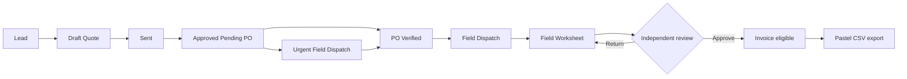
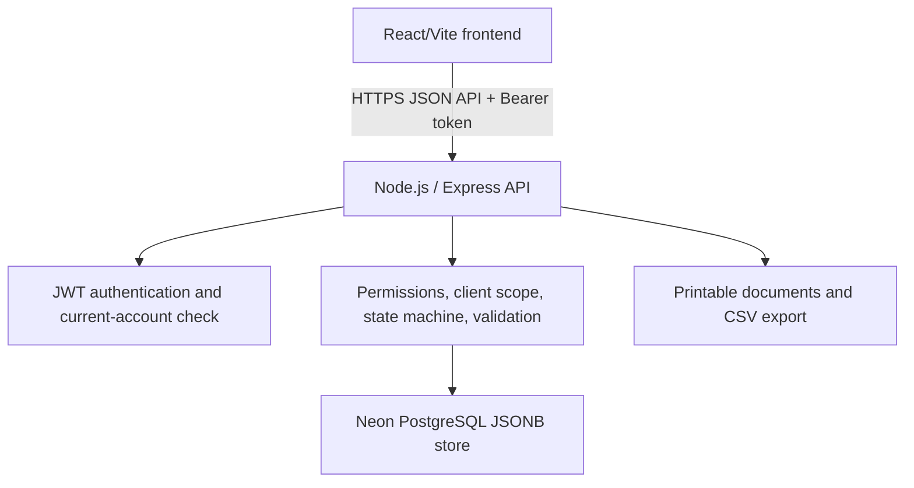

# Orac-IOS System Handover

**Audience:** Orac Systems / Handon Enterprises leadership, operational users, support staff, and future developers.  
**System purpose:** controlled, traceable industrial field-service work from lead through quotation, client authorization, field execution, invoice, and accounting export.  
**Evidence rule:** source-backed behavior and automated tests are not called live-verified until observed on the deployed system.

## Table of Contents

1. [System Status](#system-status)
2. [Business Problem and Outcome](#business-problem-and-outcome)
3. [Roles and Operating Model](#roles-and-operating-model)
4. [Business Workflow](#business-workflow)
5. [Glossary and Data Model](#glossary-and-data-model)
6. [Architecture and Deployment](#architecture-and-deployment)
7. [Security and Financial Controls](#security-and-financial-controls)
8. [User Task Guide](#user-task-guide)
9. [Operations Runbook](#operations-runbook)
10. [Acceptance, Risks, and Next Steps](#acceptance-risks-and-next-steps)

## System Status

| Area | Current status | Evidence |
| --- | --- | --- |
| Backend access and financial controls | SOURCE + AUTOMATED VERIFIED | 56 backend tests passed after code commit `7a50b95`. |
| Backend current revision | SOURCE VERIFIED | `6f51929`, including the security controls released through `7a50b95`. |
| Frontend role-scoped dashboard | SOURCE + AUTOMATED VERIFIED | Frontend commit `e91187d`. |
| Curated pilot data | SOURCE VERIFIED | Controlled fictional dataset and linked hierarchy exist in the Neon pilot store. |
| Render deployment behavior | LIVE-UNVERIFIED | Render commit confirmation and browser UAT remain required. |
| Backup restore | NOT VERIFIED | A restore drill has not yet been recorded. |

This is a private pilot. It must not be described as production-certified until the release gates in [Acceptance, Risks, and Next Steps](#acceptance-risks-and-next-steps) are complete.

## Business Problem and Outcome

Industrial service delivery often becomes hard to audit when customer requests, quotations, client purchase orders, field work evidence, labour, materials, and invoices are managed in separate spreadsheets or informal messages. Orac-IOS establishes one traceable record chain:

`Lead -> Quote -> Approved Pending PO -> PO Verified -> Dispatch -> Field Worksheet -> Invoice -> Pastel Export`

The system is designed to prevent avoidable loss and ambiguity by:

- blocking invoices until the commercial authorization and field-work evidence are complete;
- recording work, labour, material consumption, and PO variance against the dispatch;
- maintaining an audit trail for important changes;
- showing each role only the information and actions relevant to its work;
- keeping Client Viewer data server-scoped to the viewer's own organization.

## Roles and Operating Model

| Role | Business responsibility | System actions |
| --- | --- | --- |
| Admin | Governance and system administration | Manage users, master data, company profile, inventory, workflow oversight, approved financial actions. |
| Management | Operational and commercial oversight | Manage clients, assets, catalog, company profile, inventory, reports, and oversight data. |
| Sales | Commercial intake and quotation work | Create, edit, send, and progress quotations; access leads; cannot invoice or verify POs. |
| Finance | Commercial authorization and billing | Verify POs, approve amendments, generate invoices, export Pastel data, void eligible invoices with a reason. |
| Operations | Coordinate field delivery | Approve quotes, plan dispatch, manage operational inventory, and review field worksheets. |
| Supervisor | Review evidence of field work | View review-scoped dispatches and worksheets; approve or return work evidence. |
| Technician | Execute assigned field work | View assigned work, record labour/materials, create, update, and submit worksheets. |
| Client Viewer | Client self-service | View only own quotes/invoices and submit a PO for an eligible own-client quote. |

### Permission Boundaries

- Management does **not** verify POs, approve amendments, invoice, or void invoices.
- Sales does **not** verify POs, dispatch, invoice, or view generic field-work collections.
- Client Viewer has only the dedicated client PO submission permission; client data is filtered server-side.
- Technician and Supervisor receive context through assigned/review-scoped work, not generic client or quote listings.

The authoritative permission implementation is `src/permissions.js`; the current generic-read matrix is in [ORAC_IOS_QA_ACCEPTANCE_PACKET.md](ORAC_IOS_QA_ACCEPTANCE_PACKET.md).

## Business Workflow

### Quote to Invoice



Normal transitions are:

`Draft -> Sent -> Approved_Pending_PO -> PO_Verified -> Field_Dispatch -> Invoiced`

An urgent dispatch may be created from `Approved_Pending_PO` only when the actor has dispatch permission, sets `started_before_po: true`, and supplies a non-empty urgent reason. It still cannot be invoiced until the PO is later verified, the worksheet is approved, and no PO amendment remains unresolved.

### Field Evidence Review

1. A Technician or permitted field role creates a field worksheet against a dispatch.
2. The worksheet is saved as Draft or submitted for review.
3. Submission records `submitted_by` and an audit event.
4. A permitted independent reviewer approves it or returns it with a comment.
5. The worksheet submitter cannot approve their own submission.
6. The user who verified the linked PO cannot approve the linked worksheet.
7. A legacy worksheet with no reliable submission ownership fails closed and must be returned and resubmitted.

## Glossary and Data Model

| Term | Meaning | Not the same as |
| --- | --- | --- |
| Lead | Initial service enquiry before a priced proposal exists. | Quote |
| Quote | Priced proposal for defined work. | PO |
| Purchase Order (PO) | Client authorization with reference and value. | Quote or invoice |
| Dispatch Card / Job Card | Operational assignment for field delivery. | Worksheet |
| Field Worksheet | Evidence of on-site work, outcomes, tools, materials, and review. | Timesheet |
| Timesheet | Labour-hours entry linked to a dispatch card for costing. | Worksheet approval record |
| Material Usage | Job-facing record of material consumed. | Stock movement |
| Stock Movement | Inventory ledger event that changes on-hand quantity. | Material usage |
| PO Amendment | Controlled change to PO value when logged cost exceeds authorization. | Invoice |
| Invoice | Billing record generated only after policy guards pass. | Pastel export |
| Pastel Export | CSV accounting handoff for eligible invoices. | Invoice |

### Core Relationships

```text
Client -> Mine Site -> Plant -> Plant Section -> Equipment Tag
Client -> Quote -> Purchase Order -> Dispatch Card -> Field Worksheet -> Invoice
Dispatch Card -> Timesheets / Material Usage -> PO variance
Catalog Item -> Stock Item -> Stock Movement
```

## Architecture and Deployment



| Component | Current implementation |
| --- | --- |
| Frontend | React/Vite static site on Render, source repository `Orac-IOS-Industrial-Service-Management`. |
| Backend | Node.js/Express API on Render, source repository `orac-portal-api`. |
| Database | Neon PostgreSQL storing the pilot aggregate as JSONB. |
| Health endpoint | `GET /healthz`, unauthenticated by design for service probes. |
| Authentication | Signed JWT plus current-user lookup for every protected request. |
| Accounting integration | Pastel CSV export; no live Pastel API integration is claimed. |

The separate frontend and backend repositories are a deliberate pilot deployment arrangement. A monorepo migration is deferred until full source reconciliation and stable UAT are complete.

## Security and Financial Controls

| Control | Current source behavior | Evidence state |
| --- | --- | --- |
| Account revocation | Every protected request reloads the active account. Deleted/deactivated users are rejected even with a valid old token. | SOURCE + AUTOMATED VERIFIED |
| Client isolation | Client Viewer collection/document data is server-scoped to `client_id`. | SOURCE + AUTOMATED VERIFIED |
| Financial immutability | Generic archive/reactivate only handles master data; transactional records fail closed. | SOURCE + AUTOMATED VERIFIED |
| Invoice void | Admin/Finance only; requires reason; rejects paid or already voided invoices; creates audit record. | SOURCE + AUTOMATED VERIFIED |
| Negative stock | Explicit override required; only Admin and Operations may override. | SOURCE + AUTOMATED VERIFIED |
| Segregation of duties | PO verifier and worksheet submitter cannot approve the linked/same worksheet. | SOURCE + AUTOMATED VERIFIED |
| PostgreSQL TLS | Application pool requires certificate validation. Render secret still needs `sslmode=verify-full` confirmation. | SOURCE + AUTOMATED VERIFIED / LIVE-UNVERIFIED |

No credential, token, password, bcrypt hash, connection string, or client data belongs in this document, Git history, screenshots, or chat.

## User Task Guide

### Sales: Create and Send a Quote

1. Select the client and linked asset where known.
2. Add priced quote lines and save the Draft.
3. Review values before sending.
4. Send the quote; do not attempt PO verification or invoicing as Sales.

### Finance: Verify PO and Invoice

1. Open the approved-pending-PO quote.
2. Record the client PO reference and authorized amount.
3. Verify the PO.
4. Before invoicing, confirm field worksheet approval and no amendment requirement.
5. Void only an eligible invoice, with a factual reason. Paid invoices are not voided through this workflow.

### Operations: Dispatch and Inventory

1. Dispatch only authorized work; urgent dispatch requires an explicit reason.
2. Assign the appropriate technician and supervisor.
3. Record stock movements accurately and use negative override only deliberately.
4. Review worksheets only when independent of PO verification and submission duties.

### Technician: Execute and Submit Field Evidence

1. Work only from assigned dispatches.
2. Record actual activity, hours, materials, outcomes, and challenges.
3. Save Draft while incomplete; submit when evidence is ready for review.
4. A Technician cannot self-approve or invoice work.

### Supervisor: Review Field Evidence

1. Open only review-scoped worksheets.
2. Approve complete, accurate evidence or return it with a clear correction comment.
3. Do not approve a worksheet you submitted or a worksheet linked to a PO you verified.

### Client Viewer: Client Self-Service

1. Review only your organization's quotations and invoices.
2. Submit a PO reference only for an eligible quote belonging to your organization.
3. Report unexpected data visibility immediately; do not attempt workarounds.

## Operations Runbook

### Standard Release

1. Run backend tests and syntax checks.
2. Run the frontend production build.
3. Review the exact staged diff.
4. Commit one focused release and push it.
5. Confirm the corresponding Render deploy revision.
6. Run the relevant live UAT cases and update the UAT log.
7. Roll back only the focused release if the approved frontend/API behavior regresses.

### Environment Variables

Only variable names belong in documentation: `NODE_ENV`, `STORE_DRIVER`, `DATABASE_URL`, `JWT_SECRET`, `JWT_EXPIRES_IN`, and `CORS_ORIGINS`. Values must remain in the deployment provider and secure local configuration, never source control.

### Backup and Restore

1. Create or confirm a backup before any reset, migration, or seed operation.
2. Restore only into an isolated non-production Neon branch or instance.
3. Run integrity checks and the backend suite against the restored copy.
4. Record timing, result, and data-integrity observations in the UAT log.
5. Do not call the restore process production-proven until the isolated drill passes.

### Security Rotation

1. Confirm a stable deployment and backup before rotating `JWT_SECRET`.
2. Change the secret only in the backend deployment environment.
3. Redeploy and verify old sessions fail; verify fresh role logins succeed.
4. Never rotate by publishing or copying secret values into chat or code.

## Acceptance, Risks, and Next Steps

### Required Before Production Certification

1. Confirm Render deployed a revision containing backend `7a50b95` and frontend `e91187d` or later.
2. Complete and record the eight-role browser/API UAT in [ORAC_IOS_LIVE_UAT_LOG.md](ORAC_IOS_LIVE_UAT_LOG.md).
3. Perform an isolated Neon backup/restore drill.
4. Update the Render database secret to use `sslmode=verify-full`, then confirm health and deployment logs.
5. Rotate the production JWT secret after the stable release and verify fresh logins.
6. Configure structured logging, monitoring, and an alert test.

### Planned Engineering Work

- Complete a full endpoint/caller inventory before introducing a system-wide default-deny collection registry.
- Audit each role page for complete CRUD behavior and actionable empty states using the curated demo dataset.
- Reconcile the three historical source copies before any monorepo migration.
- Build individual illustrated user manuals after live UAT confirms the actual deployed screens and workflows.

## Related Records

- [QA Acceptance Packet](ORAC_IOS_QA_ACCEPTANCE_PACKET.md)
- [Live UAT Log](ORAC_IOS_LIVE_UAT_LOG.md)
- [Gap Analysis and Documentation Architecture](ORAC_IOS_GAP_ANALYSIS_AND_DOCUMENTATION_ARCHITECTURE.md)
- [External Audit and Documentation Brief](ORAC_IOS_EXTERNAL_AUDIT_AND_DOCUMENTATION_BRIEF.md)
